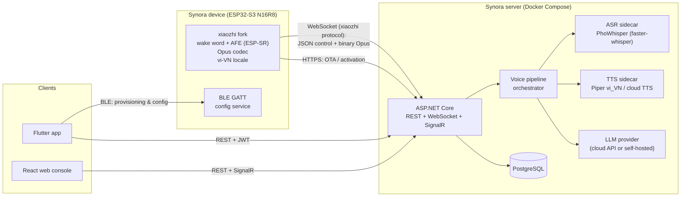
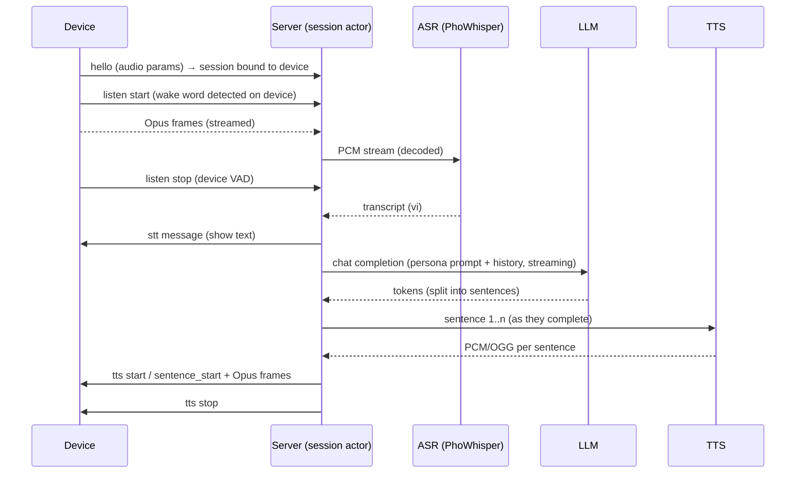

# Synora — System Design

A Vietnamese-language AI voice assistant device based on the xiaozhi ESP32 ecosystem, with a
self-hosted backend and companion apps.

**Components**

| Component | Tech | Repo dir |
|---|---|---|
| Device firmware | Custom fork of `xiaozhi-esp32` (ESP-IDF, C++) for ESP32-S3 N16R8 | `firmware/` |
| Backend server | C# / ASP.NET Core (.NET 9), Docker Compose | `server/` |
| Web console | React (Vite + TypeScript) | `web/` |
| Mobile app | Flutter (BLE provisioning + device config) | `app/` |
| Enclosure | FreeCAD (`synora.FCStd`) | `hardware/` |

---

## 1. High-level architecture



Design principle: **keep the device ↔ server contract identical to the open xiaozhi WebSocket
protocol.** This lets us validate hardware against the public xiaozhi server before ours is ready,
minimizes firmware changes, and keeps upstream merges cheap. All Synora-specific behavior
(Vietnamese pipeline, personas, BLE config) lives server-side or in additive firmware modules.

---

## 2. Firmware (`firmware/` — fork of xiaozhi-esp32)

### Target: ESP32-S3 N16R8
- 16 MB flash → custom partition table (two OTA app slots ~4 MB each, assets partition for
  wake-word model + vi-VN locale sounds/fonts, NVS for config).
- 8 MB octal PSRAM → required by ESP-SR AFE (AEC + VAD + WakeNet) and Opus buffers; enable
  `SPIRAM_MODE_OCT`.
- Assumed audio hardware (confirm against enclosure design): I2S MEMS mic (e.g. INMP441 or
  ES7210 for AEC reference), I2S amp (MAX98357A), optional display, one action button.
  → one new board config under `main/boards/synora/`.

### Changes vs upstream xiaozhi

1. **Vietnamese locale (`vi-VN`)**
   - Add `vi-VN` to the firmware i18n assets (UI strings, notification sounds, error prompts).
   - Font with full Vietnamese diacritics if a display is used.
2. **Wake word**
   - v1: ship a stock ESP-SR WakeNet model (no Vietnamese model exists off the shelf).
   - v2: custom Vietnamese wake word ("Xin chào Synora" or similar) — either Espressif's
     commercial WakeNet training service, or an integrated microWakeWord model trained on
     synthetic TTS data. Tracked as roadmap, not MVP.
3. **BLE provisioning & config service** (replaces xiaozhi's SoftAP captive portal)
   - NimBLE (lower RAM than Bluedroid; must coexist with Wi-Fi).
   - Config mode entered on first boot (unprovisioned) or by holding the button 3 s;
     advertises as `Synora-XXXX` for a limited window (5 min), LED indicates state.
4. **Server endpoints** — default OTA/WebSocket URLs point at the Synora server; overridable
   via BLE config.

### BLE GATT service (custom 128-bit UUIDs)

| Characteristic | Props | Content |
|---|---|---|
| `wifi_ssid` | write | UTF-8 SSID |
| `wifi_password` | write | UTF-8 password (write-only, never readable) |
| `wifi_scan` | read/notify | JSON list of visible APs (for pickers in the app) |
| `server_url` | read/write | WebSocket/OTA base URL override |
| `device_info` | read | device id (MAC-derived), firmware version, model |
| `settings` | read/write | JSON: volume, brightness, language, wake sensitivity |
| `activation` | read/notify | activation code once the device reaches the server |
| `control` | write | commands: `commit`, `reboot`, `factory_reset`, `test_wifi` |
| `status` | notify | provisioning state machine: `idle → joining → online → activated` / error codes |

Security: BLE pairing with LE Secure Connections ("Just Works" + limited advertising window +
physical-presence button). Wi-Fi credentials are written only while paired and stored in NVS
(flash encryption enabled in production builds).

### Device ↔ server protocol (unchanged from xiaozhi)

- WebSocket, `hello` handshake (audio params: **Opus, 16 kHz mono, 60 ms frames**).
- Binary frames = Opus audio both directions; JSON text frames = control
  (`listen start/stop/detect`, `stt`, `llm`, `tts start/sentence_start/stop`, `abort`, MCP/IoT).
- HTTPS OTA endpoint: version check + firmware URL + server config + activation code flow.

---

## 3. Server (`server/` — C#, Docker)

### Stack
- **.NET 9 / ASP.NET Core**: REST API (mobile + web), raw WebSocket endpoint (devices),
  SignalR hub (live updates to web console).
- **EF Core + PostgreSQL**.
- **Concentus** (managed Opus) for encode/decode server-side.
- **Serilog + OpenTelemetry** for logs/traces.

### Projects

```
server/
  Synora.Api/            # host: REST, WebSocket, SignalR, auth
  Synora.Core/           # domain: devices, users, personas, conversations
  Synora.Voice/          # pipeline orchestrator + provider abstractions
  Synora.Protocol/       # xiaozhi message types (hello/listen/tts/...)
  Synora.Infrastructure/ # EF Core, provider clients (ASR/TTS/LLM)
  Synora.Api.Tests/
  docker-compose.yml
```

### Voice pipeline (per connected device session)



Key properties:
- One **session actor** per device connection (a `Channel`-based async loop) — no shared
  mutable state, natural backpressure on audio frames.
- **Sentence-level streaming**: LLM output is chunked into sentences and sent to TTS eagerly,
  so first audio lands well before the LLM finishes. Target < 1.5 s wake-to-first-audio with
  cloud providers, < 2.5 s fully self-hosted on modest hardware.
- `abort` (user barge-in / wake word during playback) cancels LLM + TTS via CancellationToken.

### Provider abstraction (all swappable via config)

| Stage | Interface | Default (MVP) | Production options |
|---|---|---|---|
| ASR | `ISpeechToText` | **PhoWhisper** via faster-whisper sidecar (best open Vietnamese ASR) | FPT.AI / Viettel / Azure `vi-VN` cloud |
| LLM | `IChatCompletion` | Cloud API (good Vietnamese out of the box) | Self-hosted Qwen / Vistral via vLLM |
| TTS | `ITextToSpeech` | **Piper** sidecar (`vi_VN` voice, fully offline) | FPT.AI TTS (best quality vi voices), Azure |

ASR/TTS sidecars are small Python FastAPI containers with a streaming HTTP/WebSocket contract,
so the C# server stays free of ML dependencies.

### REST API surface (JWT auth; devices use per-device tokens)

- `POST /api/auth/*` — login/register/refresh.
- `GET/POST /api/devices` — list, bind (via activation code), rename, delete.
- `GET/PUT /api/devices/{id}/settings` — voice, volume, wake sensitivity, persona.
- `GET/PUT /api/personas` — system prompt, voice, LLM params.
- `GET /api/devices/{id}/conversations` — history with transcripts.
- `POST /api/firmware` + `GET /ota/{deviceId}` — OTA manifest + binary hosting.
- SignalR `/hubs/console` — live device status + live conversation view.

### Device activation flow (xiaozhi-style)

1. Fresh device calls OTA endpoint → server issues a 6-digit **activation code**.
2. Code surfaces two ways: spoken/displayed by the device, **and** pushed over BLE to the
   Flutter app, which auto-claims it — zero typing during onboarding.
3. Claiming binds the device to the user account and issues its long-lived device token.

### Docker Compose topology

```yaml
services:
  server:    # ASP.NET Core (multi-stage build, distroless base)
  postgres:  # + volume
  asr:       # faster-whisper + PhoWhisper-small/medium (CPU ok; GPU optional)
  tts:       # piper, vi_VN voice
  caddy:     # TLS termination + reverse proxy, serves the React build
```

---

## 4. Web console (`web/` — React)

- Vite + TypeScript, TanStack Query + Router, Tailwind + shadcn/ui. Vietnamese-first UI
  (i18n from day one: `vi` default, `en` secondary).
- Pages: **Dashboard** (devices online, usage), **Devices** (bind/rename/settings/OTA
  assignment), **Personas** (prompt, voice picker with TTS preview, LLM params),
  **Conversations** (searchable transcripts, audio replay), **Firmware** (upload builds,
  staged rollout), **Live view** (SignalR: watch a session's STT/LLM/TTS in real time —
  invaluable for pipeline debugging).

## 5. Mobile app (`app/` — Flutter)

- `flutter_blue_plus` for BLE; Riverpod for state; same REST API as the web console.
- **Onboarding wizard**: scan for `Synora-XXXX` → connect → pick Wi-Fi from `wifi_scan` list →
  write credentials → `test_wifi` → watch `status` notifications → receive activation code →
  auto-claim → done. Every failure state (wrong password, no internet, server unreachable) maps
  to a specific `status` error code with a Vietnamese message.
- **Device settings** (dual path): over BLE when near an offline device, via REST when the
  device is online — same JSON settings schema on both paths.
- Conversation history + persona switching; push notifications later.

---

## 6. Cross-cutting decisions

- **Monorepo** `synora/`: `firmware/`, `server/`, `web/`, `app/`, `hardware/`, `docs/`
  (protocol notes, GATT spec, settings JSON schema — the shared contracts live in `docs/` and
  are the source of truth for all four codebases).
- **Security**: TLS everywhere (Caddy); WSS for devices; flash encryption + secure boot on
  production firmware; BLE writes gated by pairing; per-device tokens revocable from console.
- **Latency budget** (wake → first audio): device capture+encode ~100 ms, ASR final ~400–800 ms,
  LLM first sentence ~500–900 ms, TTS first sentence ~200–400 ms, network ~100 ms.
- **Vietnamese quality risks**: (1) no off-the-shelf Vietnamese wake word — mitigated by stock
  wake word in v1; (2) open TTS voices (Piper vi_VN) are serviceable but not premium — mitigate
  with FPT.AI as a config-switch; (3) PhoWhisper handles Northern accent best — collect real
  transcripts early to evaluate Central/Southern accents.

## 7. Milestones

| # | Deliverable | Proves |
|---|---|---|
| **M0** | Devkit (S3 N16R8 + mic + amp) runs stock xiaozhi against the public xiaozhi server | hardware + audio path |
| **M1** | C# server implements the xiaozhi WS protocol end-to-end (cloud ASR/LLM/TTS); stock firmware pointed at it | protocol + pipeline |
| **M2** | BLE provisioning in firmware + Flutter onboarding wizard | onboarding UX |
| **M3** | React console: device binding, personas, conversations, live view | management plane |
| **M4** | Vietnamese depth: PhoWhisper + Piper sidecars, `vi-VN` firmware locale, provider config-switching | self-hosted vi pipeline |
| **M5** | OTA pipeline, custom board config for final hardware, flash encryption, custom wake word | production readiness |
